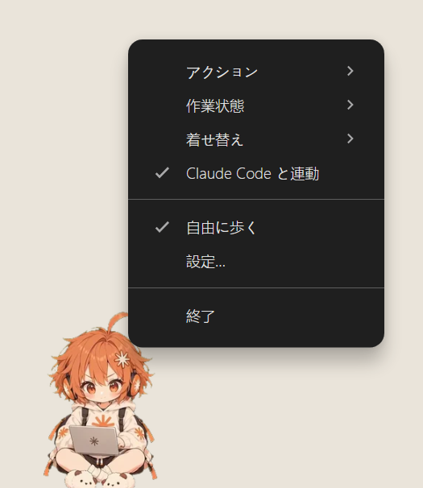
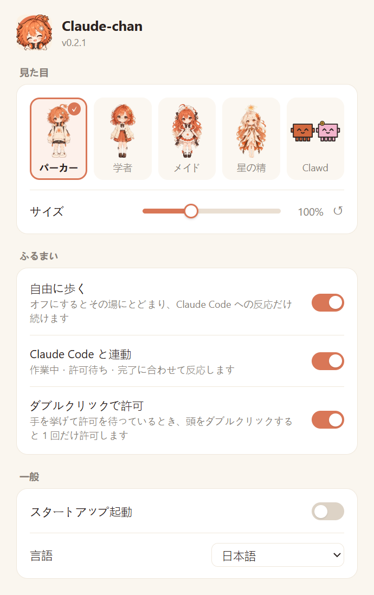

<p align="center">
  
</p>

<h1 align="center">クロードちゃん</h1>

<p align="center">
  <b>Claude Code の作業状態を、デスクトップのアニメ風マスコットで見せます。</b><br>
  デスクトップに住んで、Claude Code と一緒に働きます。<br>
  ツール実行中はノートPCをカタカタ、許可待ちでは手を挙げて、終わったらジャンプして大喜び。
</p>

<p align="center">
  <a href="README.md">English</a> | <a href="README.zh-CN.md">简体中文</a> | <b>日本語</b>
</p>

> 非公式のファンメイドプロジェクトです。Anthropic とは関係ありません。

<table align="center">
  <tr>
    <td align="center"><br>バンザイ</td>
    <td align="center"><br>あいさつ</td>
    <td align="center"><br>のび</td>
    <td align="center"><br>おにぎり</td>
    <td align="center"><br>おさんぽ</td>
  </tr>
</table>

## Claude Code との連動

<p align="center"></p>

| Claude Code が… | 彼女は… |
|---|---|
| 考え中・ツール実行中 | あぐらでノートPCをタイピング |
| 権限の許可待ち | 手を挙げて「!」の吹き出し |
| ひと区切り完了 | ジャンプしてバンザイ |

複数のセッションを同時に開いても大丈夫。どれか一つでも許可待ちなら手を挙げ、すべて終わったときだけバンザイします。

### ペットから直接承認

Claude Code が許可を求めると、彼女の横にカードが出ます。実行するコマンドや、変更するファイルと変更行が表示されます。

- **許可**・**常に許可**（Claude Code が提案するルール）・**拒否** をそのままクリック。ターミナルに切り替える必要はありません
- もっと手早く：手を挙げているときに**頭をダブルクリック**すると、1 回だけ許可します（設定でオフにできます）
- Claude Code から質問されたときは、カードに選択肢が並び、その場で答えられます

ターミナルで答えても大丈夫で、カードは自動で消えます。ペットが起動していないときは、いつも通りターミナルで聞かれます。

## 着せ替え

衣装は 5 種類。右クリック →「着せ替え」か「設定…」で切り替えます。Claude-chan の 4 着にはポーズ・歩行・アクションクリップが一式そろっています。

| パーカー | 学者 |
|:---:|:---:|
|  |  |
| **メイド** | **星の精** |
|  |  |

**Clawd**：5 つ目の衣装。彼女の代わりに Claude Code のマスコット、赤と花を付けたピンクが登場します（どちらか 1 匹でも OK）。

<p align="center"></p>

- 画面のふちを歩き回り、壁をのぼり、上辺は逆さまに進みます
- Claude Code の作業中は、赤い子が小さなノートパソコンでタイピング。ピンクの子は旗で応援し、コーヒーを運び、1 ステップごとにコードブロックを運んで積み上げます。完了すると積んだブロックがきらめいて消え、2 匹でバンザイ
- 承認待ちでは「!」と手を挙げます。手を挙げている子をダブルクリックしても許可できます
- つまんで投げると落ちてつぶれ、目を回します。壁のそばで放すと壁にしがみつきます
- ときどき追いかけっこをしたり、手をつないで歩いたり、片方がもう片方の頭に乗ったり
- 何もないときは少し歩いてはひと休み。席を離れるとその場で眠ります

## そのほか

- ひまなときは歩き回ったり、考えごとをしたり、おにぎりを食べたり、のびをしたり、手を振ったり
- クリックすると喜びます。つまみ上げると振り子のように揺れ、投げるとデスクトップに着地します
- パソコンから 5 分離れると、あくびをして眠ります。戻ると起きます
- 反応するのは彼女自身のピクセルだけ。周りの透明部分はクリックを邪魔しません

## インストール

[Releases](../../releases) からダウンロード：

| | ファイル |
|---|---|
| **Windows** 10 / 11 | `Claude-chan-Setup-x.y.z-x64.exe`（ARM PC は `-arm64.exe`） |
| **macOS**（Apple シリコン） | `Claude-chan-x.y.z-arm64.dmg` |
| **macOS**（Intel） | `Claude-chan-x.y.z-x64.dmg` |
| **Linux** | `Claude-chan-x.y.z-x86_64.AppImage` または `Claude-chan-x.y.z-amd64.deb` |

まだ Microsoft / Apple の署名がありません：

- **Windows**：「Windows によって PC が保護されました」と出たら **詳細情報 → 実行**。
- **macOS**：初回はブロックされます。**システム設定 → プライバシーとセキュリティ** で **このまま開く** を押すか、`xattr -dr com.apple.quarantine /Applications/Claude-chan.app` を実行してください。
- **Linux**：AppImage は `chmod +x` してから実行、または `sudo apt install ./Claude-chan-*.deb`。透過にはコンポジタが必要です。Wayland では XWayland 経由で動きます。Linux の Electron はピクセル単位のクリック透過ができないため、キャラクターまわりの小さな枠がマウスを受け取ります。スタートアップ起動は使えません。

**アップデート**：0.2.2 以降、新しいバージョンが出るとお知らせします。勝手にはダウンロードしません。Windows と AppImage では設定の「更新」を押すと、変わった部分だけ（ふつうは数 MB）をダウンロードして再起動します。macOS と deb では「ダウンロード」でダウンロードページを開きます。

承認カードには Claude Code **2.1.113 以降** が必要です（それより古いバージョンでは、ペットを閉じているときに権限 hook の失敗が拒否扱いになります）。

## はじめかた

1. 起動すると、彼女がデスクトップの下のほうに現れます。
2. **彼女を右クリック →「Claude Code と連動」にチェック**。これで Claude Code の作業・許可待ち・完了に合わせて反応します。
3. 着せ替え・サイズ・歩き回るかどうかは **右クリック →「設定…」** から。

「Claude Code と連動」は `~/.claude/settings.json` に 7 つの hook を追加します：

- OS 標準の `curl` でイベントを転送するので Node は不要です。ペットが起動していないときは何もせず、エラーにもなりません
- 初回の変更前に `settings.json.claude-chan.bak` としてバックアップします
- チェックを外すと一時停止です。hook は残したまま反応しなくなり、チェックを戻すとすぐ再開します（起動中の Claude Code を再起動する必要はありません）
- 完全に削除するには、設定の「Claude Code から外す」を押します。追加した hook だけを削除し、ほかの設定には触れません

## 右クリックメニューと設定

操作はすべて**彼女を右クリック**から（Clawd ではどちらの子でも）。

<p align="center">
  
  &nbsp;&nbsp;
  
</p>

| メニュー | 内容 |
|---|---|
| アクション | 考えごと、おにぎり、のび、ねる…などを再生（Clawd にはありません） |
| 作業状態 | 作業中 / 許可待ち / 完了 を手動で切り替えて見られます |
| 着せ替え | 5 種類の衣装。Clawd ではどの子を出すかも選べます |
| Claude Code と連動 | 連動のオン / 一時停止（初めてオンにしたときに hook を追加） |
| 自由に歩く | オフにするとその場にとどまり、Claude Code への反応だけ続けます |
| **設定…** | 設定ウィンドウを開きます |
| 終了 | |

設定ウィンドウでは：

- **着せ替え**、Clawd ではどの子を出すか
- **サイズ**：50〜200% のスライダー、ドラッグ中もリアルタイムに反映。↺ で標準に戻します
- **自由に歩く**、**Claude Code と連動**
- **ダブルクリックで許可**：初期値オン
- **スタートアップ起動**：初期値オフ
- **言語**：システムの言語（日本語 / English / 简体中文 / 繁體中文）に合わせます
- **アップデートを確認**：今の状態を表示。新しいバージョンがあると「更新」に変わります

## 開発

```bash
cd app
npm install
npx electron .        # 起動
npm run dist          # Windows インストーラーを app/dist/ に作成
```

ローカルエンドポイント `127.0.0.1:47823`：`POST /hook`（Claude Code hook の stdin そのまま）、`POST /permission`（承認カード用の hook）、`POST /state`（`{"state":"work"|"wait"|"done"|"idle"}`、ほかのツール向け）。ブラウザからのリクエストは拒否します。テスト用のエンドポイントは `PET_DEBUG` を設定したときだけ有効です。


## ライセンス

- コード：MIT
- キャラクターデザインと素材：CC BY-NC 4.0（クレジット表記のうえ二次創作歓迎、商用利用不可）

「Claude」は Anthropic の商標です。Clawd は Anthropic の Claude Code マスコットで、ここの 2 匹はコードで描いたファンアートです。
