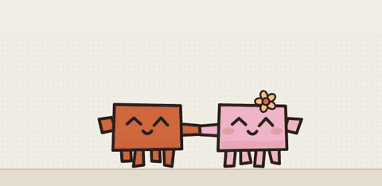
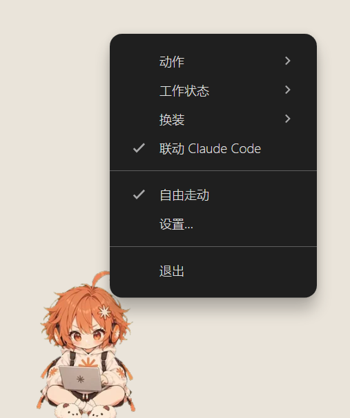
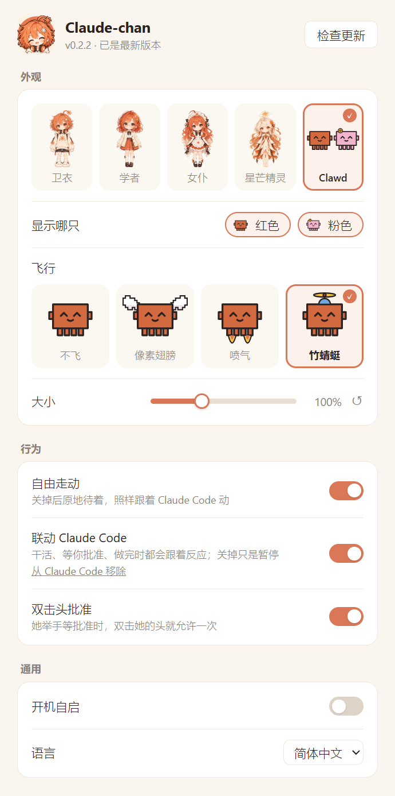

<p align="center">
  
</p>

<h1 align="center">Claude 酱</h1>

<p align="center">
  <b>把 Claude Code 的工作状态，变成桌面上的二次元桌宠。</b><br>
  她住在你的桌面上，跟着 Claude Code 一起干活：<br>
  跑命令时敲电脑，等你批准时举手，做完了跳起来欢呼。
</p>

<p align="center">
  <a href="README.md">English</a> | <b>简体中文</b> | <a href="README.ja.md">日本語</a>
</p>

> 非官方同人项目，与 Anthropic 无关。

<table align="center">
  <tr>
    <td align="center"><br>欢呼</td>
    <td align="center"><br>打招呼</td>
    <td align="center"><br>伸懒腰</td>
    <td align="center"><br>吃饭团</td>
    <td align="center"><br>走路</td>
  </tr>
</table>

## 跟 Claude Code 联动

<p align="center"></p>

| Claude Code 在… | 她在… |
|---|---|
| 思考、调工具 | 盘腿敲电脑 |
| 等你批准权限 | 举手，头上冒「!」 |
| 一轮做完 | 跳起来欢呼 |

同时开好几个会话也没关系：任何一个在等你，她就举手；全部做完才欢呼。

### 在桌宠上直接批准

Claude Code 要权限时，她旁边会弹出一张卡片，写着要执行的命令，或者要改的文件和改动的几行。

- 点 **允许**、**始终允许**（用 Claude Code 自己建议的规则）或 **拒绝**，不用切回终端
- 更快的办法：她举手的时候，**双击她的头**，直接允许一次（设置里可以关掉）
- Claude Code 问你问题时，卡片上列出选项，点一下就能回答

在终端里回答也照样可以，卡片会自己消失；桌宠没开时，Claude Code 照常在终端里问你。

## 换装

一共 5 种形态，右键 →「换装」切换，也可以在「设置…」里选。Claude 酱的四套衣服都有完整的姿势、走路和动作片段。

| 卫衣 | 学者 |
|:---:|:---:|
|  |  |
| **女仆** | **星芒精灵** |
|  |  |

**Clawd**：第五种形态，把 Claude 酱换成 Claude Code 的吉祥物，红色一只、戴小花的粉色一只（可以只放一只）。

<p align="center"></p>

- 沿着屏幕四周爬，爬上墙、倒挂着走过顶边
- Claude Code 干活时，红色那只对着小电脑敲键盘；粉色那只挥小旗加油、端咖啡，每完成一步就扛一块代码块垒到小堆上。做完时小堆闪一下消失，两只一起欢呼
- 等你批准时举手冒「!」，双击举手的那只也能批准
- 拎起来扔出去，摔下来会压扁、发晕；在墙边松手会扒住墙
- 偶尔互相追着跑、手拉手走一段，或者一只骑到另一只头上
- 没事时走走停停，多半时间坐着东张西望、打盹；你离开电脑就原地睡着

## 日常

- 闲着会自己走动、思考、吃饭团、伸懒腰、打招呼
- 点她会开心；拎起来会像钟摆一样晃，甩出去会落回桌面
- 你离开电脑 5 分钟，她打个哈欠睡着；回来就醒
- 只有点在她身上才算点到，旁边的透明区域不挡你的鼠标

## 安装

从 [Releases](../../releases) 下载：

| | 文件 |
|---|---|
| **Windows** 10 / 11 | `Claude-chan-Setup-x.y.z-x64.exe`（ARM 电脑用 `-arm64.exe`） |
| **macOS**（M 系列芯片） | `Claude-chan-x.y.z-arm64.dmg` |
| **macOS**（Intel） | `Claude-chan-x.y.z-x64.dmg` |
| **Linux** | `Claude-chan-x.y.z-x86_64.AppImage` 或 `Claude-chan-x.y.z-amd64.deb` |

安装包暂时没有微软 / 苹果的签名：

- **Windows**：可能提示「Windows 已保护你的电脑」，点 **更多信息 → 仍要运行**。
- **macOS**：第一次打开会被拦。到 **系统设置 → 隐私与安全性** 点 **仍要打开**，或者运行 `xattr -dr com.apple.quarantine /Applications/Claude-chan.app`。
- **Linux**：AppImage 先 `chmod +x` 再运行，或者 `sudo apt install ./Claude-chan-*.deb`。透明效果需要开了合成器的桌面；Wayland 下会自动走 XWayland。Linux 上 Electron 做不到按像素穿透点击，所以角色周围一个小方框会接住鼠标；也不支持开机自启。

**更新**：从 0.2.2 起，Windows 和 AppImage 会在后台下载新版本，只下变化的部分（一般几 MB），下好后在设置里点「重启更新」，或者下次退出时自动装上；macOS 和 deb 会提醒你去下载。

批准卡片需要 Claude Code **2.1.113 或更新**（更早的版本在桌宠没开时，会把权限 hook 连不上当成拒绝）。

## 上手

1. 打开后，她会出现在桌面底部。
2. **右键她 → 勾选「联动 Claude Code」**。之后 Claude Code 干活、要权限、做完，她都会跟着反应。
3. 想换装、调大小、关掉走动：**右键她 →「设置…」**。

「联动 Claude Code」会往 `~/.claude/settings.json` 加 7 条 hook：

- 用系统自带的 `curl` 把事件转给桌宠，不依赖 Node；桌宠没开时什么也不做，不会报错
- 第一次改动前备份成 `settings.json.claude-chan.bak`
- 取消勾选即卸载，只删自己加的，别的 hook 不动

## 右键菜单和设置

所有操作都从**右键她**开始（Clawd 形态右键任意一只）。

<p align="center">
  
  &nbsp;&nbsp;
  
</p>

| 菜单 | 作用 |
|---|---|
| 动作 | 让她做个动作：思考、吃饭团、伸懒腰、睡觉…（Clawd 形态没有这项） |
| 工作状态 | 手动切到 工作中 / 等你确认 / 完成，看看效果 |
| 换装 | 5 种形态；Clawd 形态下还能选显示红色、粉色哪只 |
| 联动 Claude Code | 装上 / 卸载 hook |
| 自由走动 | 关掉后原地待着，照样跟着 Claude Code 动 |
| **设置…** | 打开设置窗口 |
| 退出 | |

设置窗口里可以：

- **换装**，Clawd 形态下选显示哪只
- **大小**：50%–200% 滑块，拖的时候桌宠实时跟着变；↺ 恢复默认
- **自由走动**、**联动 Claude Code**
- **双击头批准**：默认开，不想要可以关掉
- **开机自启**：默认关
- **语言**：默认跟随系统（简体 / 繁体 / 日文 / 英文）
- **检查更新**：显示版本状态；新版本下好后这里变成「重启更新」

## 开发

```bash
cd app
npm install
npx electron .        # 运行
npm run dist          # 打 Windows 安装包到 app/dist/
```

本地接口 `127.0.0.1:47823`：`POST /hook`（Claude Code hook 原始 stdin）、`POST /permission`（批准卡片用的 hook）、`POST /state`（`{"state":"work"|"wait"|"done"|"idle"}`，给其他工具用）。来自浏览器的请求一律拒绝。测试用的接口只在设置了 `PET_DEBUG` 时存在。


## 授权

- 代码：MIT
- 角色形象与美术素材：CC BY-NC 4.0（可以二创，请署名，不可商用）

「Claude」是 Anthropic 的商标。Clawd 是 Anthropic 的 Claude Code 吉祥物，这里的两只小伙伴是用代码画的同人形象。
